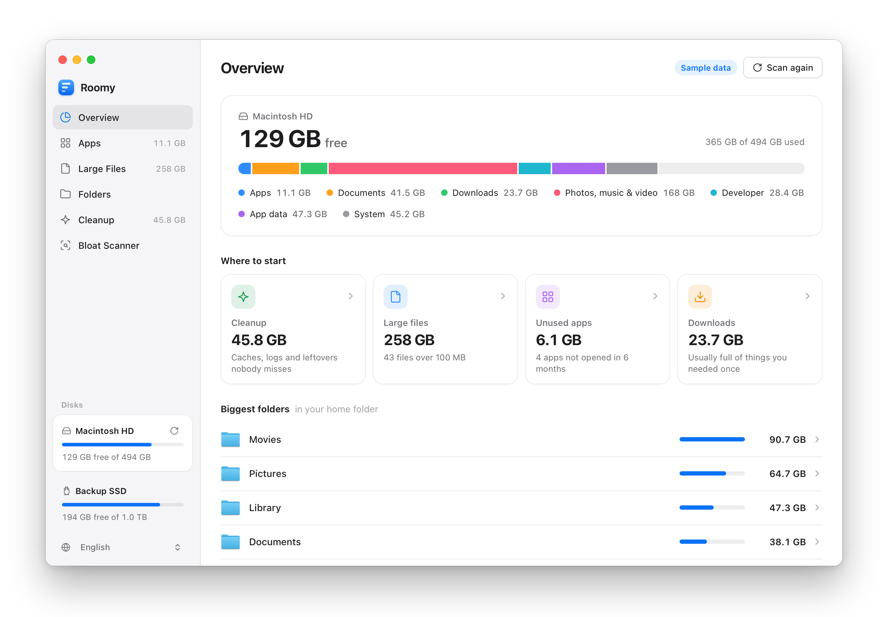
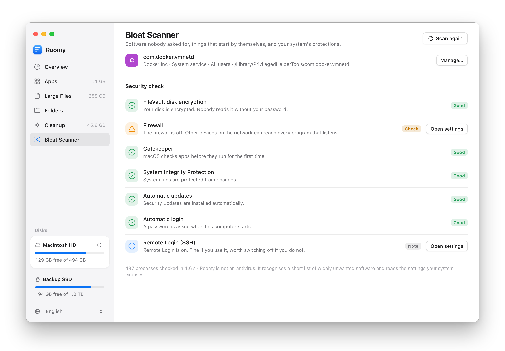
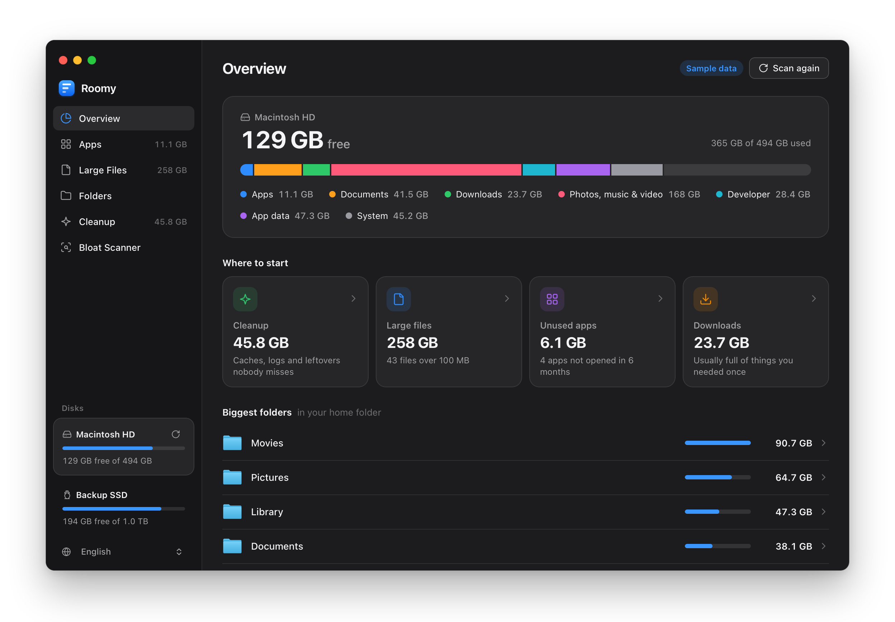

# Roomy

**See what is on your disk. Delete what you don't need.**

Roomy scans your whole computer in a few seconds and shows every app, file and folder sorted by
size, on every disk. Tick what you no longer need, press *Delete*, done. Its Bloat Scanner finds
software nobody asked for, lists what starts by itself and checks that your system's protections
are switched on. For macOS and Windows.

<p align="center">
  
</p>

## Download

| | |
|---|---|
| **macOS** (Apple silicon and Intel, macOS 12+) | [**Roomy-macOS.dmg**](https://github.com/KorelUyar/roomy/releases/latest/download/Roomy-macOS.dmg) |
| **Windows** (10 and 11, 64-bit) | [**Roomy-Windows-Setup.exe**](https://github.com/KorelUyar/roomy/releases/latest/download/Roomy-Windows-Setup.exe) |

Roomy is free and open source. It is not signed with a paid developer certificate, so both systems
ask once before the first start:

- **macOS:** the simplest way is one line in Terminal. It downloads the latest release, puts it in
  `/Applications` and opens it:

  ```sh
  curl -fsSL https://github.com/KorelUyar/roomy/releases/latest/download/install.sh | zsh
  ```

  If you use the `.dmg` instead, macOS says the app cannot be opened. Go to *System Settings →
  Privacy & Security*, scroll down and click *Open Anyway*.
- **Windows:** SmartScreen shows "Windows protected your PC". Click *More info → Run anyway*.

## What you get

<p align="center">
  
  
</p>
<p align="center">
  
  
</p>

- **Overview** — how much is free, what uses the rest, and the four places where cleaning up pays
  off most.
- **Apps** — every installed app with its size and when you last opened it. On macOS an app goes
  to the Trash together with the data it left in your Library; on Windows Roomy starts the app's
  own uninstaller.
- **Large Files** — the biggest files on the disk, filtered by type.
- **Folders** — browse the whole disk; every folder shows how big it is.
- **Cleanup** — things you can remove without missing them: the Trash, app caches, logs, build
  leftovers, installers you already used, downloads you forgot about.
- **Every disk** — the sidebar lists all internal and external drives (`C:`, `D:`, USB disks,
  volumes on a Mac). Click one to see what is on it.

Selections carry across the tabs. One bar at the bottom shows how much you picked.

### Bloat Scanner

<p align="center">
  
  
</p>

One click checks the whole computer for three things:

- **Unwanted software** — known adware, fake "optimizers" and, on Windows, the trial suites and
  promotional apps that come preinstalled. Roomy shows whether it is running right now and lets
  you quit and remove it.
- **Starts by itself** — everything that launches with your computer or runs in the background:
  launch agents, daemons and background items on macOS; startup entries on Windows. Entries that
  are unsigned, start from an odd place, or whose program no longer exists are marked. Your own
  entries can be switched off with one click.
- **Security check** — is the disk encrypted, the firewall on, are updates installed
  automatically? On macOS also Gatekeeper, System Integrity Protection, automatic login and Remote
  Login; on Windows also Microsoft Defender, User Account Control, SmartScreen and Remote Desktop.
  Each finding has a button that opens the right page in the system settings.

The Bloat Scanner is not an antivirus. It recognises a short, conservative list of widely unwanted
software ([`core/src/bloat_db.rs`](core/src/bloat_db.rs)) and reads the settings your system
exposes.

<p align="center">
  
  
</p>
<p align="center">
  
  
</p>

The screenshots show sample data.

## Safe by design

- **The Trash first.** Files, folders and apps are moved to the Trash (Recycle Bin), so you can
  get them back. *Delete immediately* is an option you have to tick. Only caches, logs and
  temporary files are removed for good, because nobody restores those.
- **System folders are locked.** Roomy refuses to delete what the operating system needs
  (`/System`, `C:\Windows`, your Library folder itself, keychains, SSH keys …). The rule is checked
  again in the backend right before anything is deleted.
- **Whole disks cannot be wiped.** A drive itself and its housekeeping folders are locked too;
  only what is on it can be selected.
- **The Bloat Scanner only looks.** The scan changes nothing. Afterwards Roomy can quit only the
  processes the scan reported as unwanted, and switch off only startup entries of your own
  account (on macOS the entry goes to the Trash, on Windows it is disabled the way Task Manager
  does it). Everything that needs an administrator is opened in the system settings instead.
- **Nothing leaves your computer.** Roomy never connects to the internet. No account, no
  telemetry, no update pings.
- **Cloud files stay in the cloud.** Files that are only in iCloud or OneDrive are counted as
  taking no space, and Roomy never triggers a download.

On macOS, Roomy works best with *Full Disk Access* (System Settings → Privacy & Security). Without
it macOS hides Mail, Messages and the Trash; everything else works.

Roomy starts in English. German can be chosen at the bottom of the sidebar, and the choice is
remembered. Light and dark mode follow the system.

## How it works

Roomy is a [Tauri](https://tauri.app) app: a Rust backend and a small React interface in the
system web view. The installer is about 5 MB.

```
core/        roomy-core: scanner, app discovery, cleanup rules, bloat scanner, delete, icons (no UI)
src-tauri/   the desktop app: one window, one `rpc` command that forwards to roomy-core
src/         the interface (React + TypeScript, no UI library)
scripts/     screenshots, end-to-end test, macOS installer
```

The scanner walks the disk in parallel and keeps only folders and big files in memory, which is
why a million files take a few seconds and little RAM.

### Build it yourself

You need [Rust](https://rustup.rs) and Node.js 22.

```sh
npm install
npm run tauri dev        # run the app
npm run tauri build      # build the installer for your system
cargo test -p roomy-core # unit tests
```

### Working on the interface in a browser

`roomy-cli serve` exposes the backend over HTTP on `127.0.0.1` (every request needs the token), so
the interface can run in a normal browser with real data:

```sh
cargo build --release -p roomy-core
./target/release/roomy-cli serve 4599 "$ROOMY_TOKEN" &
npm run build && npx vite preview --port 4173 &

open "http://localhost:4173/?bridge=http://127.0.0.1:4599&token=$ROOMY_TOKEN"   # this computer
open "http://localhost:4173/"                                                    # sample data

node scripts/e2e.mjs                         # real UI + real backend: delete, language, disks, bloat scan
node scripts/shots.mjs --out docs/screenshots # the screenshots above
```

`roomy-cli scan | disks | apps | cleanup | bloat | selftest` print the same data on the command line.

## Not there yet

- Apps from the Microsoft Store are not listed in the Apps tab on Windows (the Bloat Scanner does
  know the usual preinstalled ones).
- Network drives are not scanned.
- Startup items that belong to all users can be found but not switched off from within Roomy.
- No duplicate finder.

## Licence

[MIT](LICENSE)
