# Roomy

**See how your computer is doing, what fills its disk, and what should not be on it.**

Roomy opens with a check-up: free space, memory, processor, battery and the drive at a glance, a
malware scan with the signatures your system already trusts, and a look for software nobody asked
for. Behind it is everything on your disks sorted by size: tick what you no longer need, press
*Delete*, done. For macOS and Windows.

<p align="center">
  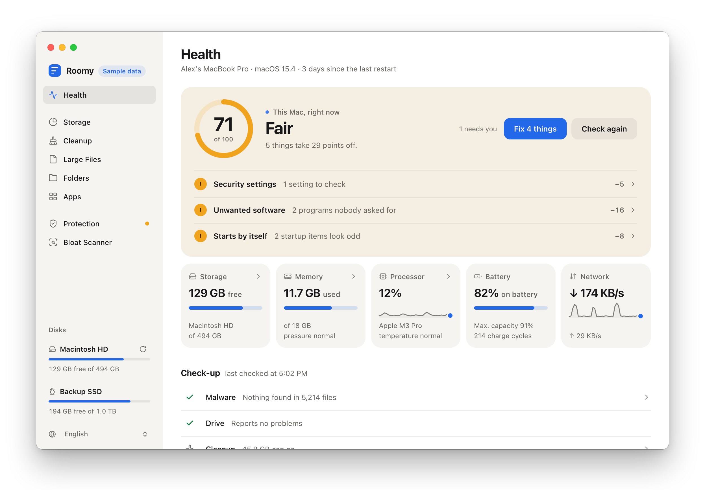
</p>

## Download

| | |
|---|---|
| **macOS** (Apple silicon and Intel, macOS 12+) | [**Roomy-macOS.dmg**](https://github.com/KorelUyar/roomy/releases/latest/download/Roomy-macOS.dmg) |
| **Windows** (10 and 11, 64-bit) | [**Roomy-Windows-Setup.exe**](https://github.com/KorelUyar/roomy/releases/latest/download/Roomy-Windows-Setup.exe) |

Roomy is free and open source. It is not signed with a paid developer certificate, so both systems
ask once before the first start:

- **macOS:** the simplest way is one line in Terminal. It downloads the latest release, puts it in
  `/Applications` and opens it:

  ```sh
  curl -fsSL https://github.com/KorelUyar/roomy/releases/latest/download/install.sh | zsh
  ```

  If you use the `.dmg` instead, macOS says the app cannot be opened. Go to *System Settings →
  Privacy & Security*, scroll down and click *Open Anyway*.
- **Windows:** SmartScreen shows "Windows protected your PC". Click *More info → Run anyway*.

## What you get

### Health

- **Four numbers, live:** free space, memory in use (with the memory pressure macOS reports), the
  processor's load over the last minutes, and the battery with its charge cycles and how much of
  its original capacity is left.
- **Check now** runs the check-up: the security settings, what starts by itself, unwanted software
  and, on a Mac, a quick malware scan. The result is one sentence ("3 things to look at") with
  exactly those things listed under it; each line leads to the tab that deals with it.
- **The drive's own verdict** (S.M.A.R.T.), what could be cleaned up, and apps you have not opened
  in half a year.
- **Using the most memory:** the apps that hold the most right now, and with one switch the
  programs in the background too. Apps can be asked to quit from there (the polite way: they may
  still ask you to save).

<p align="center">
  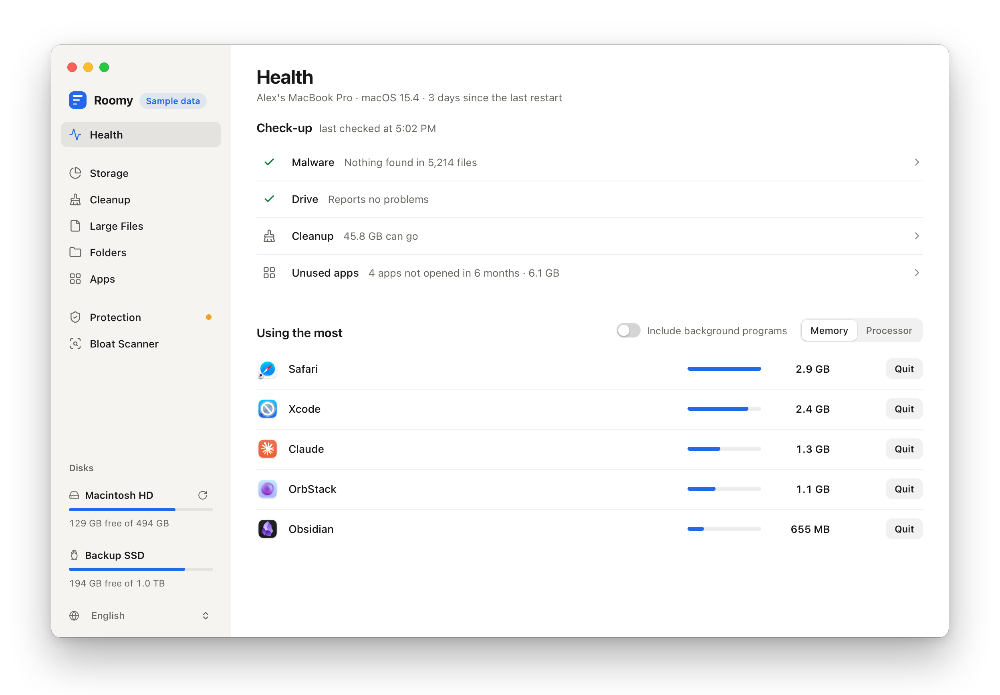
  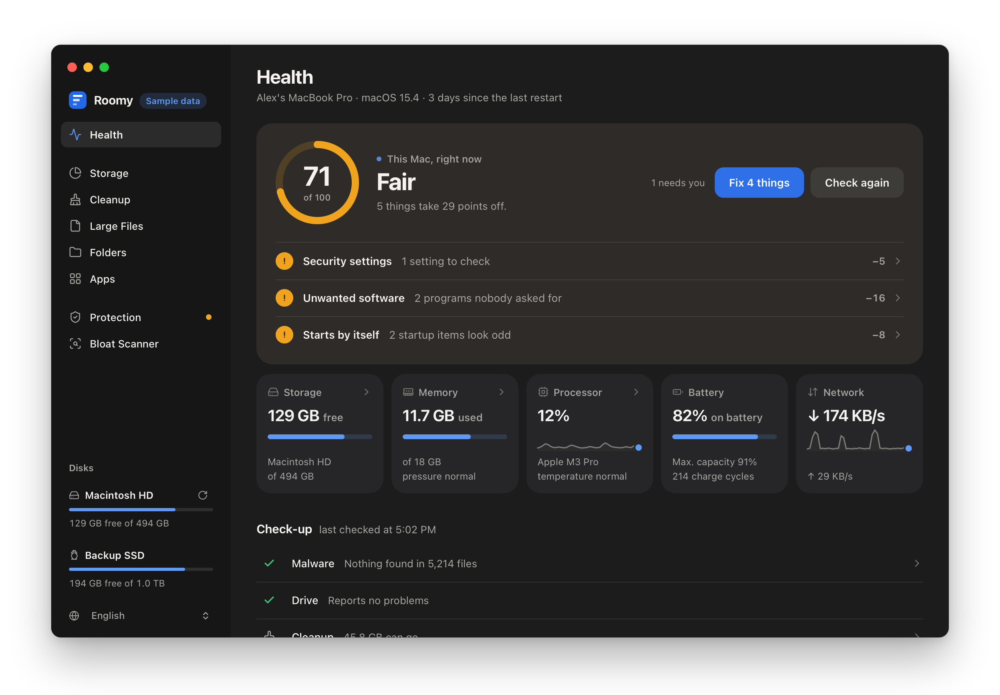
</p>

### Storage

<p align="center">
  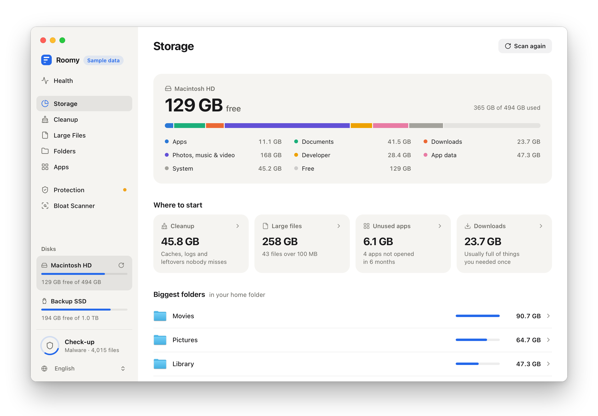
  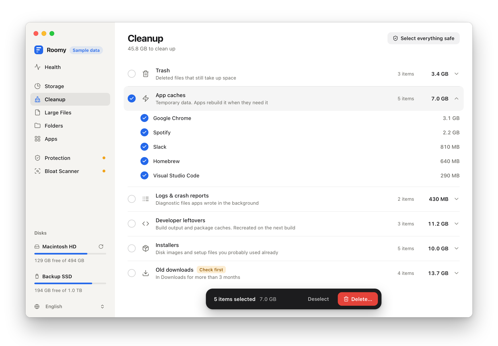
</p>
<p align="center">
  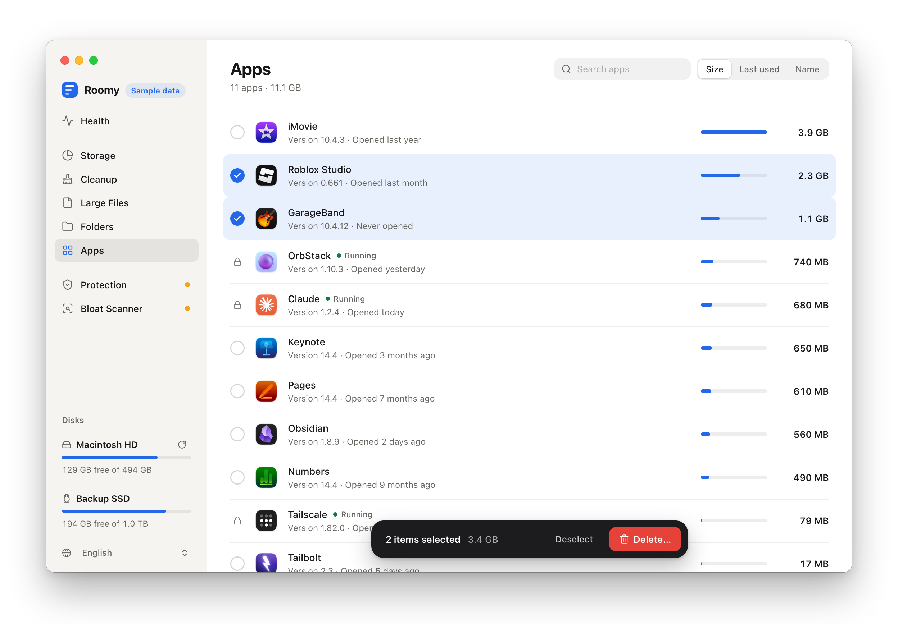
  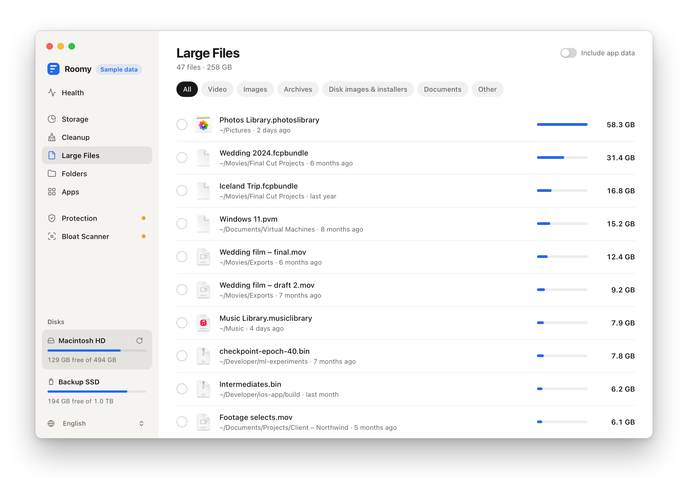
</p>
<p align="center">
  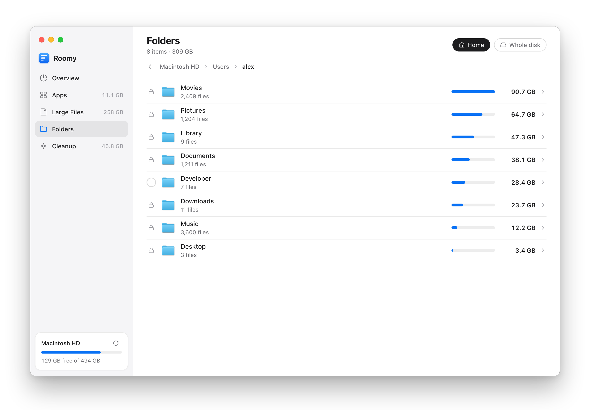
  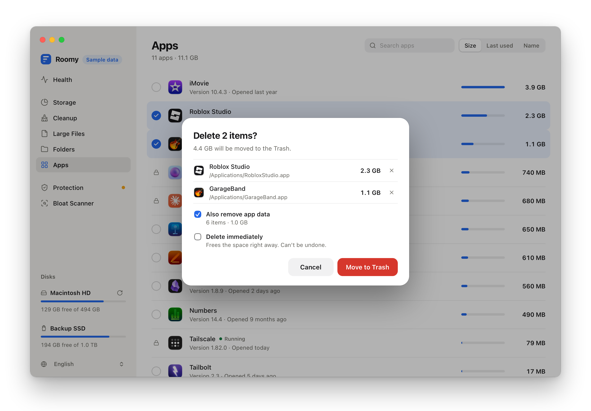
</p>

- **Storage** — how much is free, what uses the rest, and the four places where cleaning up pays
  off most.
- **Cleanup** — things you can remove without missing them: the Trash, app caches, logs, build
  leftovers, installers you already used, downloads you forgot about.
- **Large Files** — the biggest files on the disk, filtered by type.
- **Folders** — browse the whole disk; every folder shows how big it is.
- **Apps** — every installed app with its size and when you last opened it. On macOS an app goes
  to the Trash together with the data it left in your Library; on Windows Roomy starts the app's
  own uninstaller.
- **Every disk** — the sidebar lists all internal and external drives (`C:`, `D:`, USB disks,
  volumes on a Mac). Click one to see what is on it.

Selections carry across the tabs. One bar at the bottom shows how much you picked.

### Protection

<p align="center">
  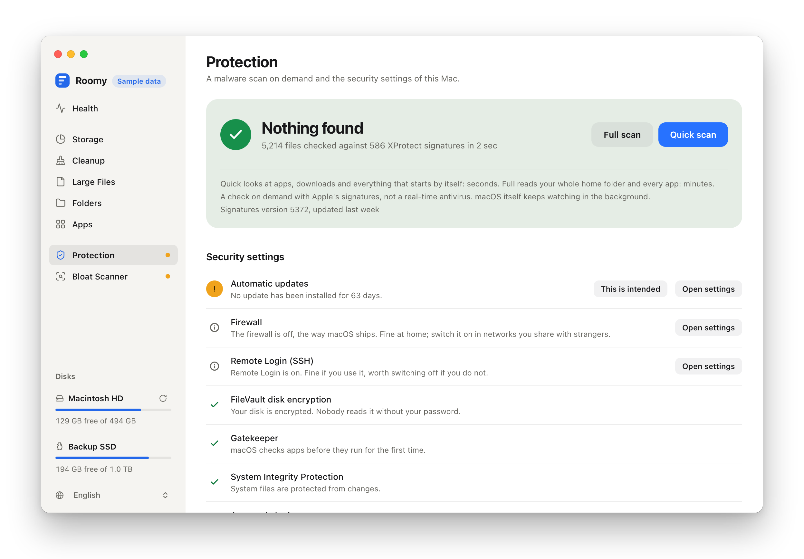
  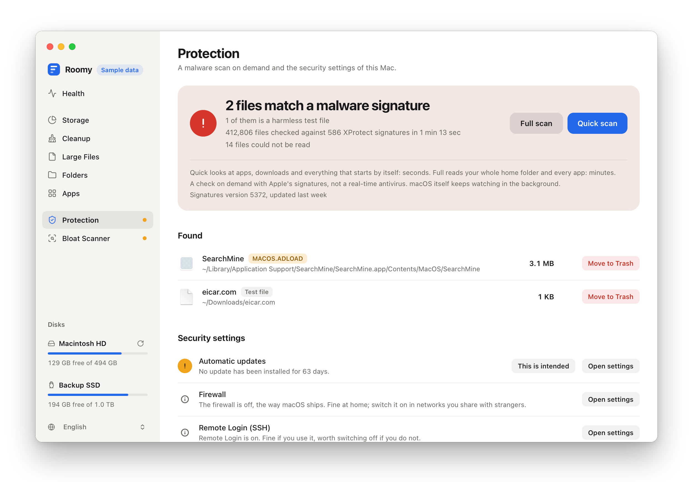
</p>

- **Malware scan.** Roomy has no signatures of its own and does not pretend to.
  - On a **Mac** it reads Apple's XProtect signatures from your system (the rules macOS itself
    applies when a download is first opened) and checks the files that are already there. *Quick*
    looks where malware usually sits: the programs of every app, downloads, the desktop and
    everything that starts by itself; it takes seconds. *Full* reads your whole home folder and
    every app; a few minutes. A file that matches a signature can be shown in Finder or moved to
    the Trash.
  - On **Windows** it asks Microsoft Defender to scan and shows what Defender found and dealt
    with.
- **Security settings.** Is the disk encrypted, the firewall on, are updates installed
  automatically? On macOS also Gatekeeper, System Integrity Protection, automatic login and Remote
  Login; on Windows also Microsoft Defender, User Account Control, SmartScreen and Remote Desktop.
  Each finding has a button that opens the right page in the system settings, and one to say
  "this is intended": a setting you switched off on purpose then stops counting.

Roomy checks when you ask. It does not watch in the background: that stays the job of macOS and
of Microsoft Defender. To see that the scan works, put the
[EICAR test file](https://www.eicar.org/download-anti-malware-testfile/) into your Downloads: it
is found and named as the harmless test file it is.

### Bloat Scanner

<p align="center">
  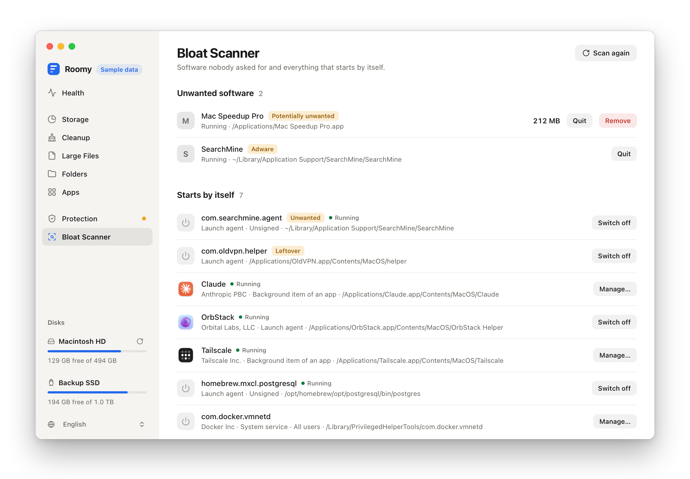
  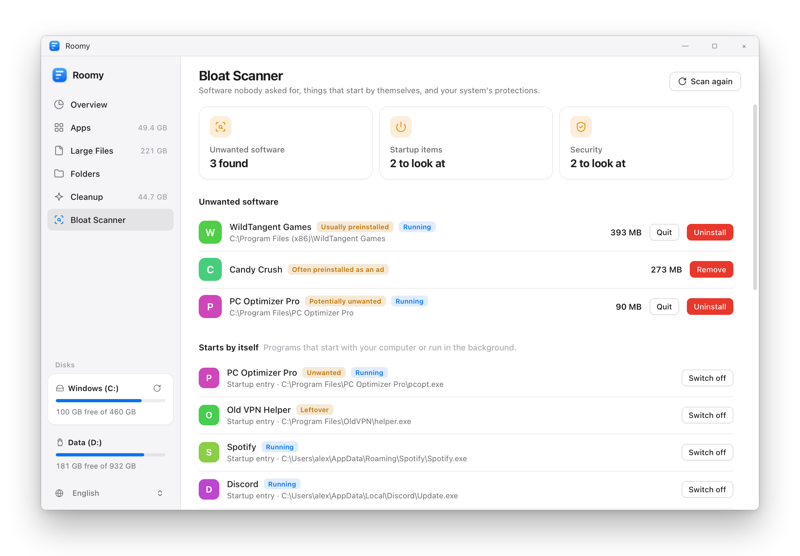
</p>

- **Unwanted software** — known adware, fake "optimizers" and, on Windows, the trial suites and
  promotional apps that come preinstalled. Roomy shows whether it is running right now and lets
  you quit and remove it.
- **Starts by itself** — everything that launches with your computer or runs in the background:
  launch agents, daemons and background items on macOS; startup entries on Windows. Entries that
  are unsigned, start from an odd place, or whose program no longer exists are marked. Your own
  entries can be switched off with one click.

The list of unwanted software is short and conservative
([`core/src/bloat_db.rs`](core/src/bloat_db.rs)).

<p align="center">
  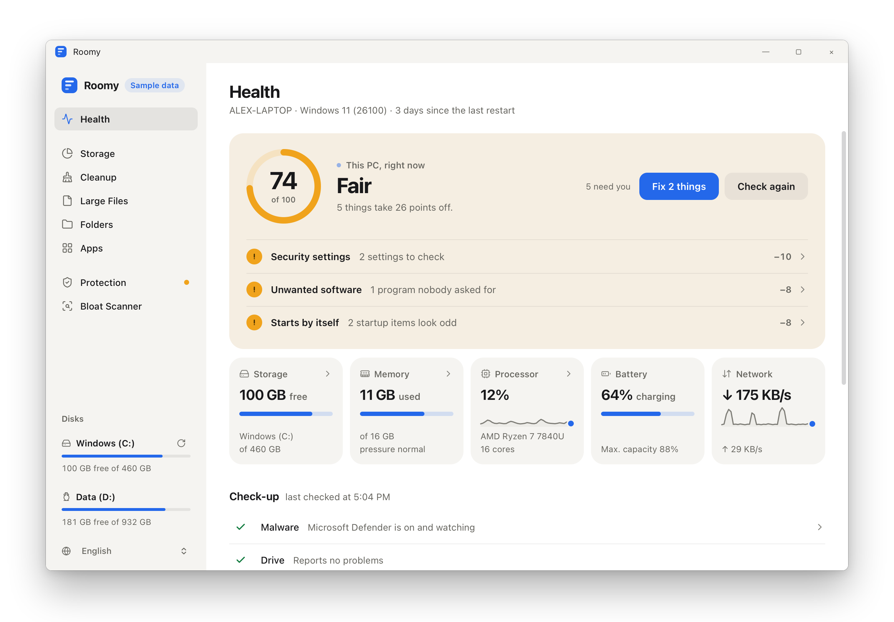
  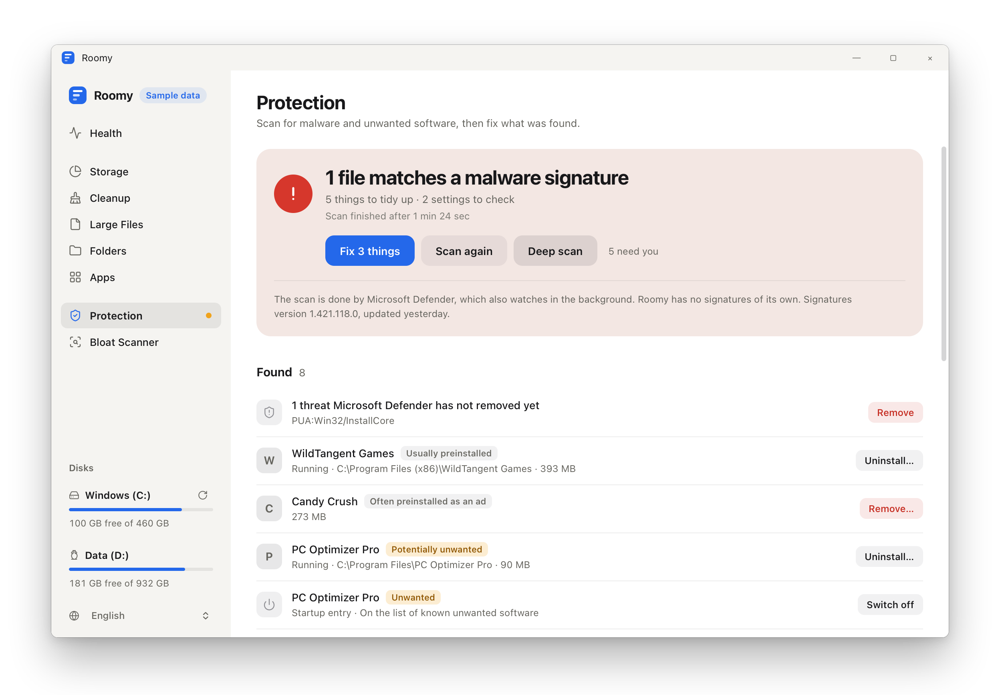
</p>
<p align="center">
  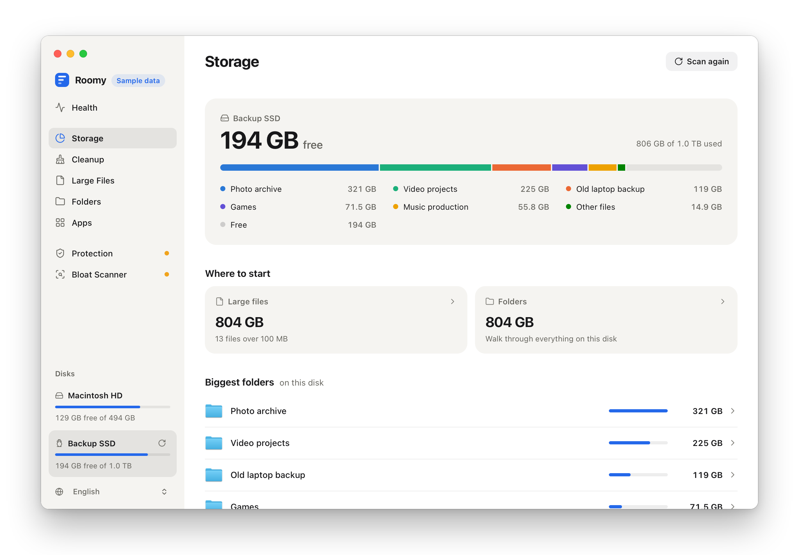
</p>

The screenshots show sample data.

## Safe by design

- **The Trash first.** Files, folders and apps are moved to the Trash (Recycle Bin), so you can
  get them back. *Delete immediately* is an option you have to tick. Only caches, logs and
  temporary files are removed for good, because nobody restores those.
- **System folders are locked.** Roomy refuses to delete what the operating system needs
  (`/System`, `C:\Windows`, your Library folder itself, keychains, SSH keys …). The rule is checked
  again in the backend right before anything is deleted.
- **Whole disks cannot be wiped.** A drive itself and its housekeeping folders are locked too;
  only what is on it can be selected.
- **Scans only look.** The check-up, the malware scan and the Bloat Scanner change nothing. A
  malware scan reads files and nothing else: it follows no links, stays on the disk it started
  on, and leaves network and cloud drives alone. Removing what it found is a separate step through
  the same dialog as every other delete. Roomy can quit only the processes a scan reported, and
  switch off only startup entries of your own account (on macOS the entry goes to the Trash, on
  Windows it is disabled the way Task Manager does it). Everything that needs an administrator is
  opened in the system settings instead.
- **Nothing leaves your computer.** Roomy never connects to the internet. No account, no
  telemetry, no update pings. The malware signatures are the ones already on your computer.
- **Cloud files stay in the cloud.** Files that are only in iCloud or OneDrive are counted as
  taking no space, are not scanned, and Roomy never triggers a download.

On macOS, Roomy works best with *Full Disk Access* (System Settings → Privacy & Security). Without
it macOS hides Mail, Messages and the Trash; everything else works.

Roomy starts in English. German can be chosen at the bottom of the sidebar, and the choice is
remembered. Light and dark mode follow the system.

## How it works

Roomy is a [Tauri](https://tauri.app) app: a Rust backend and a small React interface in the
system web view. The installer is a few megabytes.

```
core/        roomy-core: scanner, app discovery, cleanup rules, health, malware scan, bloat scanner, delete, icons (no UI)
src-tauri/   the desktop app: one window, one `rpc` command that forwards to roomy-core
src/         the interface (React + TypeScript, no UI library)
scripts/     screenshots, end-to-end test, macOS installer
```

The scanner walks the disk in parallel and keeps only folders and big files in memory, which is
why a million files take a few seconds and little RAM.

The malware scan on macOS compiles Apple's XProtect rules (YARA, read from
`/var/protected/xprotect` or `/Library/Apple/System/Library/CoreServices`) with
[boreal](https://github.com/vthib/boreal), a YARA engine written in Rust, and runs them over the
files with four workers. No signatures ship with Roomy. On Windows it calls Microsoft Defender's
own `Start-MpScan` and reads the detections afterwards.

### Build it yourself

You need [Rust](https://rustup.rs) and Node.js 22.

```sh
npm install
npm run tauri dev        # run the app
npm run tauri build      # build the installer for your system
cargo test -p roomy-core # unit tests
```

### Working on the interface in a browser

`roomy-cli serve` exposes the backend over HTTP on `127.0.0.1` (every request needs the token), so
the interface can run in a normal browser with real data:

```sh
cargo build --release -p roomy-core
./target/release/roomy-cli serve 4599 "$ROOMY_TOKEN" &
npm run build && npx vite preview --port 4173 &

open "http://localhost:4173/?bridge=http://127.0.0.1:4599&token=$ROOMY_TOKEN"   # this computer
open "http://localhost:4173/"                                                    # sample data

node scripts/e2e.mjs                         # real UI + real backend: delete, language, disks, check-up, malware scan
node scripts/shots.mjs --out docs/screenshots # the screenshots above
```

`roomy-cli scan | disks | apps | cleanup | bloat | health | malware [full] | selftest` print the same
data on the command line.

## Not there yet

- Apps from the Microsoft Store are not listed in the Apps tab on Windows (the Bloat Scanner does
  know the usual preinstalled ones).
- Network drives are not scanned.
- Startup items that belong to all users can be found but not switched off from within Roomy.
- The malware scan is a check on demand, not a guard in the background, and it knows what Apple's
  or Microsoft's signatures know. On Windows Roomy only shows what Microsoft Defender found.
- No duplicate finder.

## Licence

[MIT](LICENSE)
